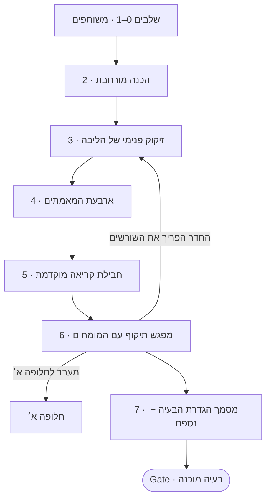

# חקר הבעיה · חלופה ב׳ — זיקוק במטה, תיקוף בחדר

> חלק מ[תת-שלב 1 · חקר הבעיה](01-חקר-הבעיה.md). הקובץ הראשי מכיל את השלבים המשותפים (0–1), את [בחירת החלופה](01-חקר-הבעיה.md#בחירת-החלופה), את [מסמך הגדרת הבעיה](01-חקר-הבעיה.md#השלב-המסכם--גיבוש-הגדרת-הבעיה-הסופית) ואת ה-Gate.
> **החדר הוא חדר מייעץ:** ליבת ה-Mission Squad מזקקת את הבעיה בעצמה, ומומחי התוכן מגיעים לחדר כדי לתקף. החלופה האחרת: [חלופה א׳ · זיקוק בחדר](01א-חקר-הבעיה-זיקוק-בחדר.md).
> *(אושר לפלייבוק 26.11.2026.)*

## למה החלופה הזו

בחלק מאזורי התוכן לשותפים לא תהיה סבלנות לעבור את כל תהליך הזיקוק בחדר: חלקם כבר עשו עבודה כזו, או כבר יודעים את התשובות, ועלולים להתייחס לתהליך בציניות. כאן את עבודת הזיקוק עושים במטה, ומביאים לחדר חומר מוכן לתיקוף.

החלופה בנויה **מאותם כלים** כמו חלופה א׳: עץ בעיות, Five Whys ושלושת הקריטריונים לבחירת שורש. ההבדל הוא **מי** מפעיל אותם ו**איפה**.

## השלבים

שלבים 0–1 (RFI לשטח, מיפוי מקורות והעלאת חומר) — [משותפים](01-חקר-הבעיה.md#תהליך--השלבים-המשותפים), ללא שינוי.

**שלב 2 · הכנה מורחבת** ([`md-session-prep`](../.claude/skills/md-session-prep/SKILL.md), במצב מורחב)
אותו [מסמך הכנה](../06-כלים-ותבניות/מסמך-הכנה-תבנית.md), בהיקף מלא יותר: מחקרים, נתונים כמותיים, פתרונות בעולם, מפת שחקנים והשערות שורש. המסמך משמש את המפגש הפנימי של הליבה, ולא רק את החדר. **צוות המומחים הסוכני** משמש בשלב הזה **ככלי עזר** בלבד — מקור נוסף להשערות לפי שיקול ה-Mission Lead, ולא חלק קבוע מהחלופה *(הוכרע 26.11.2026)*.
> ⛔ [כלל הייחוס](../08-ארכיטקטורת-המימוש/02-הגדרת-המיזם/חוזה-ההנחיה.md#-מצב-הכנה--כלל-הייחוס) חל כאן באותה חומרה: לכל השערה מקור.

**שלב 3 · זיקוק פנימי של ליבת ה-Mission Squad** (מפגש עבודה פנימי)
עץ בעיות ו-Five Whys על החומר שנאסף, עם אותם מנחים כמו בחלופה א׳ ([`md-converge-facilitator`](../.claude/skills/md-converge-facilitator/SKILL.md), [`md-inquiry-facilitator`](../.claude/skills/md-inquiry-facilitator/SKILL.md)). לאורך המפגש: [`md-session-capture`](../.claude/skills/md-session-capture/SKILL.md).
תוצר: **2–3 שורשים מועמדים** · **שורשים שנשללו ולמה** · **רשימת "מה לא יודעים"**.

**שלב 4 · עיבוד ותיקוף — לפני החדר**
ארבעת המאמתים ([`md-evidence-validation`](../.claude/skills/md-evidence-validation/SKILL.md), [`md-data-validation`](../.claude/skills/md-data-validation/SKILL.md), [`md-ai-fit`](../.claude/skills/md-ai-fit/SKILL.md), [`md-market-scan`](../.claude/skills/md-market-scan/SKILL.md)) רצים על השורשים המועמדים **לפני** המפגש עם המומחים — כך שהמומחים מקבלים ממצאים ולא רק השערות. הבדיקות זהות ל[שלב 4 בחלופה א׳](01א-חקר-הבעיה-זיקוק-בחדר.md#השלבים). [`md-output-review`](../.claude/skills/md-output-review/SKILL.md) מציף מתחים בין המאמתים לפני המפגש.

**שלב 5 · חבילת קריאה מוקדמת** (טיוטה: [`md-document-drafting`](../.claude/skills/md-document-drafting/SKILL.md) · Mission Lead מאשר לפני השליחה)
נשלחת למומחים **3 ימים לפני המפגש**, בכמה עמודים לכל היותר:
- עץ הבעיות
- השורשים המועמדים, עם הראיות והמקור לכל טענה
- השורשים שנשללו, ולמה
- שאלות פתוחות ממוקדות — כאלה שרק המומחים יכולים לענות עליהן

**שלב 6 · מפגש תיקוף עם המומחים** (Mission Squad, כולל Domain Experts)
**מונחה באותו אופן ועם אותם משתתפים כמו [מפגש פריסת הבעיה בחלופה א׳](01א-חקר-הבעיה-זיקוק-בחדר.md#השלבים)** — אותם מנחים, אותו [חוזה הנחיה](../08-ארכיטקטורת-המימוש/02-הגדרת-המיזם/חוזה-ההנחיה.md) *(הוכרע 26.11.2026)*. ההבדל הוא בחומר שעליו עובדים: שורשים מועמדים מוכנים במקום דף ריק.
1. הצגה קצרה של החבילה.
2. עבודה על כל שורש: **אישוש, הפרכה או השלמה** — עם ציון מי אמר מה.
3. מענה לשאלות הפתוחות.
4. **המלצת החדר על השורש**, לפי אותם שלושה קריטריונים: עמוק מספיק · גבוה מספיק · AI הוא הכלי הנכון ([`md-converge-facilitator`](../.claude/skills/md-converge-facilitator/SKILL.md) מוודא שהם מיושמים עקבית, ואינו בוחר).

[`md-output-review`](../.claude/skills/md-output-review/SKILL.md) מציף סתירות מול הממצאים, ו-[`md-session-capture`](../.claude/skills/md-session-capture/SKILL.md) מתעד כל שינוי שהחדר הכניס.

> **החדר הפריך את השורשים המרכזיים?** הליבה חוזרת לזיקוק הפנימי (שלב 3), או שעוברים לחלופה א׳ ([מעבר בין חלופות](01-חקר-הבעיה.md#בחירת-החלופה)).

**שלב 7 · גיבוש הגדרת הבעיה הסופית** — [השלב המסכם](01-חקר-הבעיה.md#השלב-המסכם--גיבוש-הגדרת-הבעיה-הסופית) בקובץ הראשי, **בתוספת נספח: מה השתנה בעקבות התיקוף.**

## כללים שמונעים מהחדר להפוך לחותמת גומי

> **הסיכון המרכזי של החלופה הזו הוא הטיית אישור:** החדר מקבל חומר מוכן ורק מהנהן. הכללים האלה מחייבים.

- **מביאים חלופות, לא מסקנה אחת.** לפחות שני שורשים מועמדים, ולצדם השורשים שנשללו והסיבה.
- **כל טענה עם מקור,** לפי [כלל הייחוס](../08-ארכיטקטורת-המימוש/02-הגדרת-המיזם/חוזה-ההנחיה.md#-מצב-הכנה--כלל-הייחוס).
- **"מה לא יודעים" מוצג במפורש**, ולא מוחלק בניסוח בטוח.
- **החדר רשאי לפתוח מחדש.** אם המומחים מפריכים את השורשים המרכזיים — חוזרים לזיקוק הפנימי או עוברים לחלופה א׳.
- **מודדים כמה השתנה.** הנספח "מה השתנה בעקבות התיקוף" נשמר בכל מיזם. אם מפגשי התיקוף כמעט אף פעם לא משנים דבר — זה סימן אזהרה שהחדר רק מאשר.

## תרשים



## לוח זמנים (כ-4–5 שבועות)

*(אושר 26.11.2026.)* ההכנה המורחבת, הזיקוק הפנימי, ארבעת המאמתים וחבילת הקריאה נכנסים כולם לימים 2–5. המאמתים רצים תוך שעות, וחבילת הקריאה כוללת את ממצאיהם — ולכן הם רצים לפני שהיא נסגרת.

```
שבועיים–שלושה → RFI: פרסום + חלון מענה (מקביל לתחילת מיפוי המקורות) — זהה לחלופה א׳
יום 1          → הגדרת מקורות וגישה לדאטה (ליבת ה-Mission Squad)
ימים 2–3       → הכנה מורחבת (אייג'נט)
ימים 3–4       → זיקוק פנימי של ליבת ה-Mission Squad (מפגש של חצי יום)
יום 4          → ארבעת המאמתים על השורשים המועמדים (אייג'נט)
יום 5          → חבילת קריאה מוקדמת: ניסוח, אישור Mission Lead ושליחה
ימים 6–8       → חלון קריאה למומחים (3 ימים)
יום 9          → מפגש תיקוף (2–3 שעות)
יום 10         → מסמך הגדרת הבעיה + נספח "מה השתנה"
```

> **מפגש תיקוף שני** (רק אם החדר הפריך את השורשים המרכזיים) מוסיף כשבוע. לפי [עיקרון דרגות החופש](../00-חזון-ועקרונות/README.md#עיקרון-העל-האדם-מנהל-את-התהליך-לא-להפך), ה-Mission Lead רשאי לקצר את חלון הקריאה, ומתעד זאת בכרטיס המיזם.
